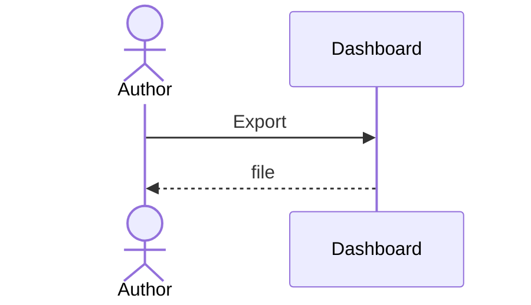

# UC-013 Export the list

**Goal.** The author takes the list away as a file.

## Actors

- **Author** — wants the list as a file.
- **GitHub** — hosts the list.

## Precondition

- The list exists.

## Main flow

1. The author presses **Export**.
2. The dashboard writes the file.

## Alternative flows

- **1a. The list is empty.** Nothing is written.

### 1b. A detail under a lower heading stays in its section

## Postcondition

- The file holds the list.
